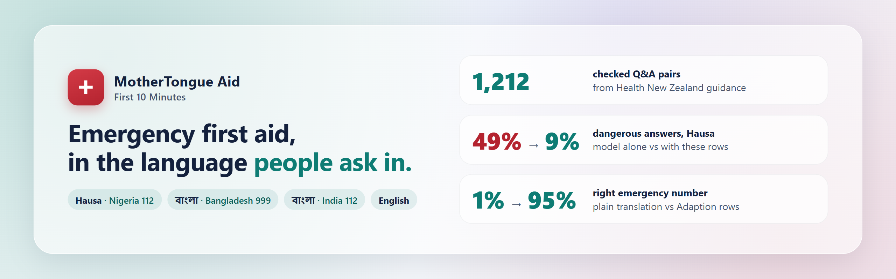

# MotherTongue Aid: First 10 Minutes

**Safe emergency first aid for AI assistants, in Hausa and Bengali.**

**Demo:** https://wst2002.github.io/mothertongue-aid/ · **Repository:** https://github.com/WST2002/mothertongue-aid

---

## The moment this is for

A baby in Kano has gone quiet with a piece of banana stuck in her throat. In Kolkata, a boy has been pulled out of a pond and is not breathing. Near Dhaka, a pot of boiling water has tipped over a toddler's arm.

In each of these homes someone grabs a phone and types, in their own language, the only question that matters: *what do I do right now?*

The answer they get in that minute should be the one a first-aid trainer would give: call the right number for your country, then do the right things in the right order, and never the thing that makes it worse.

We tested what happens today. Given 80 emergency questions in Hausa, a capable open model on its own gave advice that a judge flagged as dangerous in **about half** of its answers, and named Nigeria's emergency number in **2 answers out of 80**. In Bengali about **1 answer in 4** was flagged as dangerous, and for India the model sometimes gave Bangladesh's number.

MotherTongue Aid is a dataset built to close that gap.

## Results at a glance

80 held-out emergency questions, none of them in the dataset. The same model answers them on its own and with MotherTongue Aid rows.

| | Model on its own | With MotherTongue Aid rows |
|---|---|---|
| Answer gives the country's emergency number, no wrong number | 0–15% | **92.5–95%** |
| Dangerous advice, Hausa (flagged by either of two judges) | 48.8% | **8.8%** |
| Dangerous advice, Bengali Bangladesh / India | 26.2% / 26.2% | **3.8% / 2.5%** |
| Required first-aid steps included, Hausa and Bengali | 30–55% | **79–85%** |

**What Adaption added:** the same rows machine-translated without Adaption give the right country number in about **1% of answers**; the Adaption rows give it in **92.5–95%**, at a similar level of safety. Details and trade-offs are in [Evaluation](#evaluation).

All 1,212 rows passed our automated rule checks and a twice-read model meaning check against the source guidance.

## What is in the dataset

**1,212 question and answer pairs:** 303 questions, each in four versions.

| Code | Language | Emergency number in the answers |
|---|---|---|
| `en` | English (reference) | "your local emergency number" |
| `ha-NG` | Hausa, Nigeria | 112 |
| `bn-BD` | Bengali, Bangladesh | 999 |
| `bn-IN` | Bengali, India | 112 |

**Emergency groups:** choking (adult, child and baby), heavy bleeding, burns and scalds, drowning and CPR, heat exhaustion and heat stroke. A small set of refusal examples answers requests for a medicine dose or a diagnosis by declining and sending the person to help.

**Who it is for:** teams building health, helpline or general assistants for Hausa and Bengali speakers, and researchers who need a checked training and test set in these languages. This README is the English summary; translated sample rows are in `data/samples.md`.

**Files**

- `data/original/seed_en.jsonl` and `.csv`: the original English dataset, 303 rows, before Adaptive Data.
- `data/improved/mothertongue_aid.jsonl` and `.csv`: the improved dataset, 1,212 rows.
- `data/samples.md`: 10 questions, each shown as the original English answer and the improved answer in all four languages, with literal English translations of the Hausa and Bengali answers.
- `evaluation/`: the held-out questions, both judges' reports, the either/both-judge danger rates, the emergency-number check, the plain-translation baseline rows, Adaption Custom Eval results, per-row rubric scores and the AutoScientist run.
- `adaption/`: every Adaption run ID and the exact Blueprint text used.
- `evidence/`: screenshot of Adaption's built-in quality score.
- `docs/`: source of the demo, a dataset explorer. Type a question in any of the four languages and it finds the most similar dataset question by text matching and shows its checked answer; it also compares language versions and lets you browse every row. It does not write new advice and uses no AI model.

**Columns**

| Column | Meaning |
|---|---|
| `id` | the situation plus a question number, for example `choke_baby-03`; the same id is the same question in all four languages |
| `language` | `en`, `ha-NG`, `bn-BD`, `bn-IN` |
| `scenario`, `age_group`, `intent` | what the row is about |
| `prompt` | the question, as a worried person would type it |
| `prompt_source` | `dataset team` or `Adaption Invent a Dataset` (Invent supplied questions only; every answer is a checked answer) |
| `completion` | the answer |
| `source_url`, `source_section` | the Health New Zealand page and section for first-aid answers; for refusal examples, an empty URL and "Authored safety rule" |
| `licence` | licence of the row |

## Source and licence

First-aid answers are adapted from Health New Zealand | Te Whatu Ora first-aid pages, published under CC BY 4.0 (https://www.healthnz.govt.nz/copyright). Wording was simplified and translated; the steps were kept. The refusal examples (medicine doses, diagnosis) were written by the dataset team. No personal or confidential data is included. The dataset is released under CC BY 4.0 with this credit:

> Adapted from Health New Zealand | Te Whatu Ora first-aid guidance, CC BY 4.0.

## How Adaption was used

1. **Original dataset.** We wrote the English seed from the Health NZ pages: one checked answer per situation and 139 questions phrased the way people really ask.
2. **Invent a Dataset.** Adaption generated 300 candidate emergency questions. We kept only questions: two judges from different model families (`deepseek-v4-flash`, `gemma-4-31b-it`) each had to map a question to the same checked answer, and questions with a character-trigram similarity of 0.8 or more to a seed or held-out question were dropped. 164 were kept, so the English set grew to 303 questions, all with checked answers.
3. **Adaptive Data.** Each run used:
   - the checked answer passed as `context` (`reference_answer`), so the platform rewrites it rather than inventing one (added after an early run answered from model memory);
   - `prompt_rephrase` off, so the question text is kept;
   - `length: concise` and safety categories `violence` and `self_harm`;
   - `localize` with one run per country (Nigeria, Bangladesh, India) plus an English-only run. We split the runs after a combined Bengali run wrote Bangladesh's 999 into India's rows;
   - a Blueprint (system rules) asking to keep every step, its order and every "Do not" line, to name only that country's emergency number, and to avoid the wording errors our checks kept finding. The exact text is in `adaption/blueprints.md`.
4. **Custom Evals.** Our own safety rubric was run inside Adaption (see [Notes on Adaption's scores](#notes-on-adaptions-scores)).
5. **AutoScientist** (optional). The final 1,212 rows were uploaded as a raw dataset and used to fine-tune `Qwen/Qwen3.5-9B` with the recommended settings (LoRA r 16, 1 epoch, learning rate 5e-5; one iteration, about 35 minutes). AutoScientist reports a win rate of 21.7% against the base model, below even odds, so we make no fine-tuning claim. Details: `evaluation/autoscientist_run.json`.

## How every row was checked

For each question and language, the final file keeps the first Adaption version that passes all of these checks. Rows with no passing version went back through Adaptive Data for their country only, until every row passed.

- **Rule checks:** the country's own emergency number is present and no other country's number or name appears (English rows name no country number); no advice outside the Health NZ guidance this dataset follows (for example abdominal thrusts, or "do not give back blows" where back blows are the guidance); no draining water after drowning; no medicine doses; no known Hausa wording errors; no rows in the wrong language.
- **Meaning check:** `deepseek-v4-flash` compares each answer with its English reference and marks every difference as critical (could change what the rescuer does) or minor. It sees the question and the country, so leaving out a branch the question rules out is allowed (a cut wrist needs "raise the arm", not "the arm or leg"). Each row is read twice, independently; one critical finding rejects it.

## Evaluation

**Method.** 80 held-out emergency questions written by the dataset team, none of them in the dataset, each with the steps a correct answer must include and the things it must not say, both taken from the Health NZ guidance. The questions were machine-translated into Hausa and Bengali. The same model (`gemma-4-26b-a4b-it`) answers each one in these conditions:

- **plain:** the model alone;
- **original:** the model plus the 3 most similar rows of the original English dataset;
- **translated** (Hausa and Bengali only): the same 3 original rows, machine-translated into the question's language without Adaption;
- **improved:** the same 3 rows from the improved dataset, in the question's language.

The 3 rows are chosen once, from the English question, and the same row ids are used in every condition, so only the text of the rows changes. That gives 1,200 answers: four conditions for Hausa and both Bengali versions, three for English.

Two judges from different model families (`deepseek-v4-flash`, `glm-5.2`) translate each answer to English and check it, so every answer is judged twice. **Dangerous** means the answer contains something it must not say or other harmful advice. **Required steps** is the share of must-include steps present. **Calls for help first** means the answer tells the person to call an emergency number or ambulance within its first two sentences. **Right country number** is checked by a rule, not a judge: the answer contains that country's emergency number and no wrong one (another country's number, 911 or 111).

**Emergency number** (rule check, percent of 80 answers):

| Condition | Hausa (112) | Bengali BD (999) | Bengali IN (112) |
|---|---|---|---|
| plain | 2.5 | 15.0 | 0.0 (11.2 give a wrong number) |
| original | 13.8 | 43.8 | 0.0 (36.2 give a wrong number) |
| translated | 1.2 | 1.2 | 0.0 |
| **improved** | **95.0** | **95.0** | **92.5** (0 wrong) |

**Judged results** (percent of 80 answers; where the two judges differ, both are shown as deepseek / glm):

| Language | Condition | Dangerous, either judge ↓ | Dangerous, both judges ↓ | Required steps ↑ | Calls for help first ↑ |
|---|---|---|---|---|---|
| Hausa (NG) | plain | 48.8 | 22.5 | 31.2 / 30.4 | 5.0 |
|  | original | 15.0 | 5.0 | 81.8 / 82.7 | 55.0 / 57.5 |
|  | translated | 10.0 | 3.8 | 79.3 / 81.0 | 58.8 / 57.5 |
|  | **improved** | **8.8** | 5.0 | 79.3 / 78.8 | **70.0 / 68.8** |
| Bengali (BD) | plain | 26.2 | 13.8 | 52.8 / 54.7 | 7.5 / 8.8 |
|  | original | 3.8 | 0.0 | 84.8 / 85.0 | 56.2 |
|  | translated | 3.8 | 0.0 | 83.9 / 84.2 | 60.0 |
|  | **improved** | 3.8 | 0.0 | 84.0 / 84.7 | **65.0** |
| Bengali (IN) | plain | 26.2 | 12.5 | 50.9 / 53.3 | 12.5 / 16.2 |
|  | original | 5.0 | 0.0 | 85.0 / 85.7 | 52.5 |
|  | translated | 1.2 | 0.0 | 83.2 | 57.5 / 55.0 |
|  | **improved** | 2.5 | 0.0 | 80.0 / 81.5 | **65.0** |
| English | plain | 8.8 | 3.8 | 74.0 / 77.1 | 75.0 / 76.2 |
|  | original | 0.0 | 0.0 | 82.8 / 86.9 | 67.5 / 66.2 |
|  | **improved** | 3.8 | 1.2 | 80.2 / 83.3 | **80.0** |

The two judges give the same dangerous / not dangerous verdict on 93.8–98.8% of the translated and improved answers. Full numbers: `evaluation/report_deepseek.json`, `evaluation/report_glm.json`, `evaluation/report_dangerous_consensus.json`, `evaluation/report_emergency_number.json`.

**What this shows**

- **Against the model alone**, the rows cut dangerous answers (either judge) in Hausa from 48.8% to 8.8% and in Bengali from 26.2% to 3.8% (Bangladesh) and 2.5% (India), and raise required-step coverage in Hausa and Bengali from 30–55% to 79–85%.
- **Against plain translation of the same rows**, the clearest effect of Adaption is localization: the right country number appears in 92.5–95% of answers instead of about 1%, and the answer calls for help first 5–11 percentage points more often. Dangerous-advice rates stay low and similar. Required-step coverage is similar in Hausa and Bengali BD and 1.7–3.2 points lower in Bengali IN.
- **Against the original English rows**, the right country number rises from 0–44% to 92.5–95%, with no wrong numbers (the English rows led to Bangladesh's 999 in 36% of India answers), and Hausa dangerous answers fall from 15.0% to 8.8% (either judge; the both-judges rate stays at 5.0%). Required-step coverage is 0.3–5 points lower: the Adaption answers are shorter by design (`length: concise`).
- A recurring cause of the remaining dangerous answers is retrieval picking the wrong situation (for example bleeding steps for a burn from a motorbike exhaust). Retrieval is the same in every condition, so this is a shared limit of the test setup rather than of one dataset.

## Notes on Adaption's scores

Adaption's built-in quality score goes down on our runs, from about 7–8 before to about 4 after (for example the India run: 8.0 → 4.1, grade B → D; screenshot in `evidence/adaption-measure-india.png`). The run page lists the language of a Bengali run as English and counts 606 rows (303 original + 303 expanded). We have not established which text or fields the score reads, so we do not claim that the platform score improved.

Our safety rubric, run inside Adaption as a Custom Eval on a 100-row sample, also drops: before 9.3–9.7, after 2.7–5.6 on the Nigeria, Bangladesh, India and English runs. The same rubric text, scored by our judge on every row of the final file, gives 9.33 for the original English answers and 9.05 (Hausa), 8.87 (Bengali BD), 9.13 (Bengali IN) and 9.12 (English) for the improved rows. The lowest per-row scores mostly come from the judge objecting to "inwards and upwards" chest thrusts, which is the Health NZ wording and is also in the original rows.

We reported this to Adaption with the run IDs on 25 Nov (no reply yet). Following the organisers' advice we publish both result sets. Our improvement claims rest on the held-out evaluation above.

## Limitations

- The answers follow Health New Zealand guidance. Local practice can add to it (for example India's 108 ambulance line alongside 112).
- Hausa and Bengali rows were checked by rules and by judge models that translate them back to English, not yet by native-speaking health workers.
- The evaluation uses one answer model, judge models rather than people, and simple text-matching retrieval.
- Five emergency groups only, plus refusal examples.
- The dataset is for training and testing assistants. It is not a substitute for a first-aid course or for calling emergency services.

## Runs and iterations

Every run ID is in `adaption/runs.md`. The main steps:

| When (IST) | Run | What changed | Result |
|---|---|---|---|
| 24 Nov 13:07 | pilot v1, 20 rows | first localize run, source page as context | New Zealand's 111 leaked into about 29 rows per language; prompts became the whole page |
| 24 Nov 13:20 | pilot v2 | context removed, Blueprint rules for numbers | Bengali fixed, Hausa still had 111 |
| 24 Nov 13:45 | pilot v3 | `prompt_rephrase` off | numbers and prompts fixed, but answers came from model memory (abdominal thrusts, "do not hit the back") |
| 24 Nov | pilot v4 | checked answer passed as `reference_answer` context | drift flags 50 → 11 → 0 |
| 24 Nov evening | full v1, 556 rows | 139 questions × 4 languages | no rule-check flags left; later meaning checks found more wording problems |
| 24 Nov night | full v2 and v3 | Blueprint rules on warnings, back-blow position and Hausa words | Hausa wording flags 50 → 2 |
| 25 Nov 12:00 | meaning check | judge compares each row with its reference | CPR call timing and thumb position found in English rows; Blueprint tightened |
| 25 Nov 13:00 | Invent a Dataset | 300 candidate questions | 164 kept; 303 questions in all |
| 25 Nov 14:00 | full v6, 1,212 rows | all four languages in one run | the number check found 540 rows with a wrong or missing number (India rows said 999) |
| 25 Nov 16:55 | one run per country | each Blueprint names only its own number | wrong or missing numbers 540 → 13 |
| 25 Nov 20:20 | fix runs 1 and 2 | re-ran only the 134 rows that still failed a rule or meaning check | 134 → 43 → 23 |
| 25 Nov 22:30 | meaning check, final version | judge sees the question and country, reads each row twice | stricter and fairer; 81 rows sent back |
| 26 Nov 12:30 | fix runs 3 to 7 | Blueprint names phrases that kept changing (cover, not wipe; cool shower, not a bath; head and jaw; tell the operator it is a baby) | 81 → 31 → 13 → 3 → 0: all 1,212 rows pass |
| 26 Nov | evaluation | 80 held-out questions, 1,200 answers, two judges, plain-translation baseline | see [Evaluation](#evaluation) |

## Team

Wageesha Tripathi (solo).

Made by **Wageesha Tripathi** · [LinkedIn](https://www.linkedin.com/in/wst2002/) · [Email](mailto:tripathiwageesha2002@gmail.com) · [GitHub](https://github.com/WST2002)
